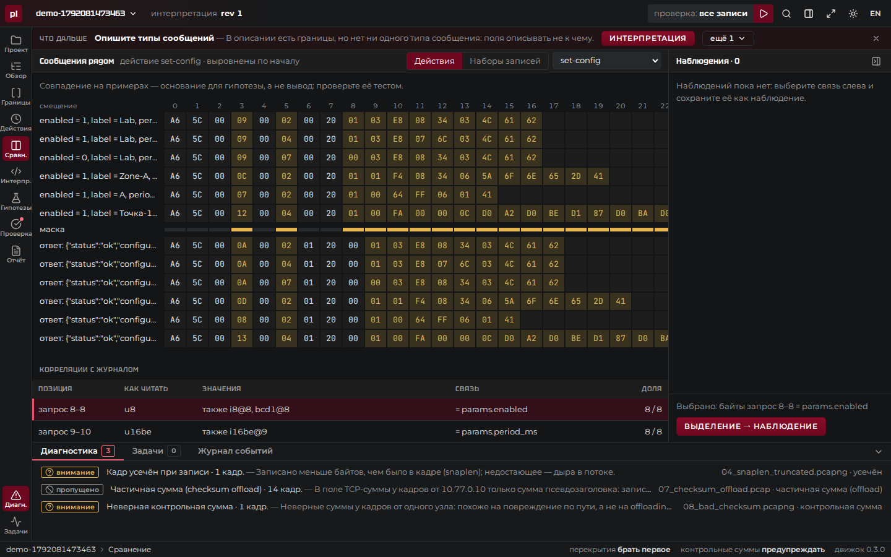
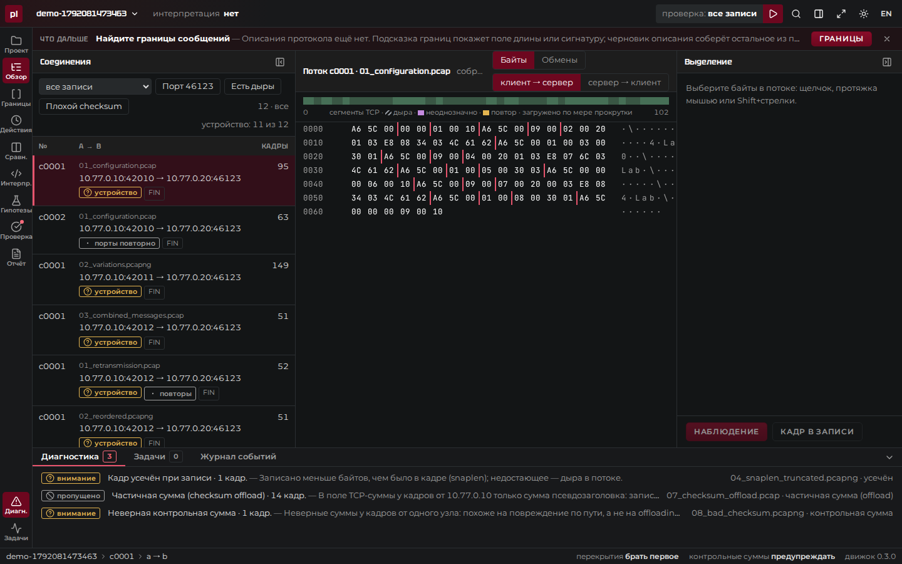
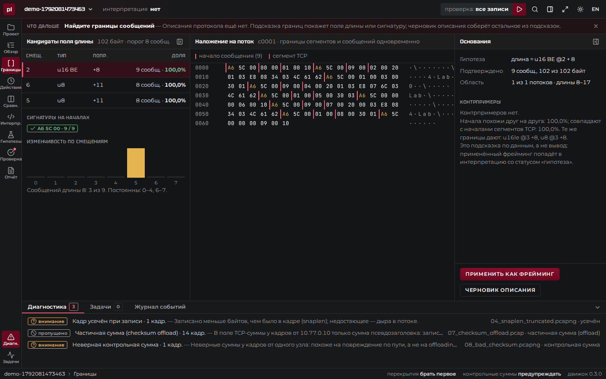
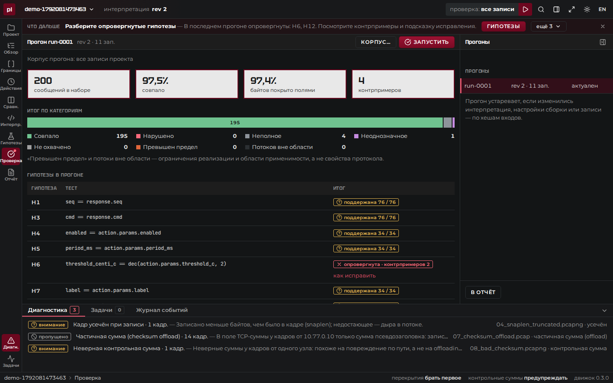
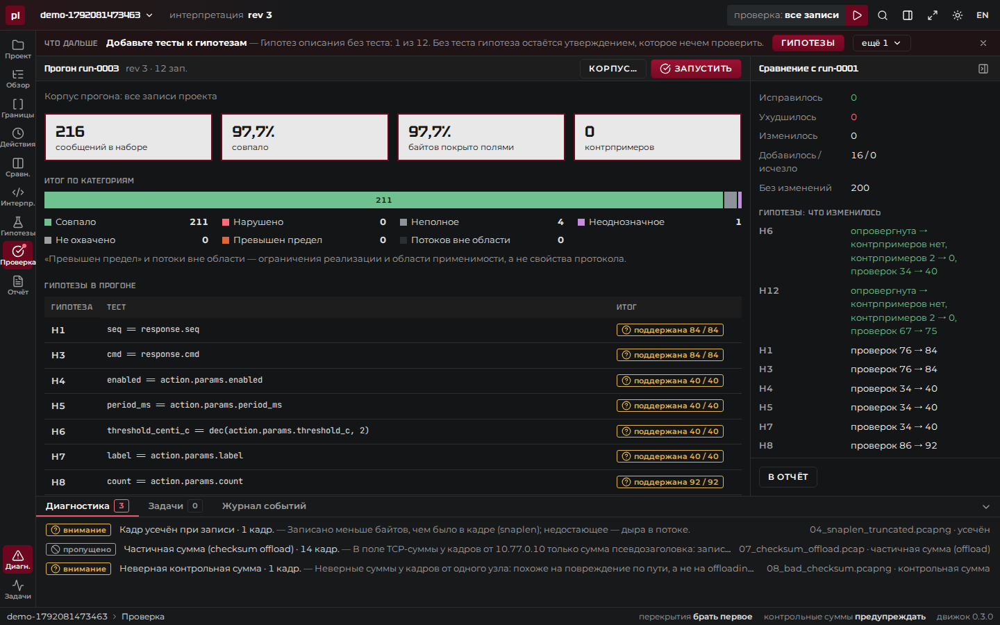

# protoledger

Лаборатория для исследования недокументированных бинарных протоколов поверх TCP: от записей трафика к проверяемому и переносимому описанию обмена.

> **Статус: в разработке.** Разделы «Быстрый старт», «Как пользоваться» и «Демо» заполняются по мере готовности.



## Какую задачу решает

Подключить систему к устройству без документации на протокол — обычная задача интеграции: промышленные контроллеры, измерительные приборы, медицинское и торговое оборудование, IoT, устаревшие сервисы. Обычно это Wireshark, hex-редактор, заметки и одноразовые скрипты: выводы не привязаны к данным, не проверены на других записях и не передаются коллеге.

protoledger превращает записи обмена (PCAP/PCAPNG) и журнал действий в штатном клиенте в описание протокола, которое:

- **проверяемо** — каждый вывод привязан к конкретным байтам конкретной записи, противоречия видны как контрпримеры;
- **повторно применимо** — то же описание запускается на новых записях одной командой, без ручной работы;
- **переносимо** — исследование хранится в папке проекта и воспроизводится на другой машине.

## Для кого

| Кто | Зачем |
|---|---|
| Инженер-интегратор | Найти команды и значения в обмене устройства и получить описание для реализации |
| Разработчик драйвера, шлюза, эмулятора | Машиночитаемое описание, примеры и автоматическая проверка реализации |
| Инженер поддержки и QA | Понять, что изменилось после обновления прошивки или клиента |
| Руководитель, подрядчик | Передать и принять исследование вместе с основаниями выводов |

## Цикл работы

1. **Открыть записи** — соединения и направленные потоки, собранные по TCP sequence numbers; повторы, дыры и неоднозначности показаны явно.
2. **Исследовать** — найти обмен по действию из журнала, сравнить примеры с разными параметрами, отметить наблюдения на байтах.
3. **Описать** — фрейминг, типы сообщений, поля; каждое поле — правило, гипотеза или неизвестная зона.
4. **Проверить** — применить описание к корпусу: сводка по всему набору, контрпримеры, сравнение с прошлой проверкой.
5. **Передать** — отчёт с основаниями, машиночитаемое описание, папка проекта, команда повторного применения.

Тот же цикл на наборе организаторов шаг за шагом, с командами, — [docs/guide.md](docs/guide.md).

Работает локально и офлайн: настольное приложение, интерфейс в браузере на localhost и командная строка.

## Быстрый старт

Требования: Linux x86-64, Docker с Compose v2, git.

```bash
git clone --recursive https://github.com/protoledger/protoledger.git
cd protoledger
cp .env.example .env
docker compose up --build
```

Интерфейс: http://localhost:8080.

### Без Docker: готовый бинарник

На странице [Releases](https://github.com/protoledger/protoledger/releases) — архив `protoledger-<версия>-linux-x86_64.tar.gz`: статический бинарник, интерфейс встроен, библиотеки и сеть не нужны.

```bash
tar -xzf protoledger-*-linux-x86_64.tar.gz
./protoledger serve --workspace ~/protoledger
```

Интерфейс: http://127.0.0.1:8080. Там же — сборки для Windows и macOS (`.zip`, `.tar.gz`) и `SHA256SUMS`.

### Настольное приложение

В Releases — установщики: Windows `.msi`, Linux `.deb` и AppImage. Приложение поднимает движок внутри себя и открывает интерфейс в своём окне; проекты по умолчанию — в папке «Документы/protoledger».

- Windows: установщик не подписан — в окне SmartScreen «Подробнее» → «Выполнить в любом случае».
- Linux: нужен WebKitGTK 4.1 (`sudo apt install libwebkit2gtk-4.1-0` в Debian и Ubuntu 22.04+); AppImage — `chmod +x protoledger_*.AppImage && ./protoledger_*.AppImage`.

### Командная строка

`protoledger apply` применяет описание протокола к новой записи без проекта, `verify` перепроверяет перенесённый проект, `report` собирает отчёт — подробнее в [docs/requirements.md](docs/requirements.md#как-повторить-проверку-руками).

Описание API — `API.md` и `openapi.yaml` в [репозитории движка](https://github.com/protoledger/protoledger-backend); Swagger UI есть только в dev-сборке ([docs/dev.md](docs/dev.md)).

## Как пользоваться

Пример — набор организаторов «Термостенд» (`examples/thermostand`): записи обмена клиента с измерительным устройством и журнал действий оператора. Протокол считается неизвестным. Полный проход с объяснением каждого шага и командами — [docs/guide.md](docs/guide.md).

**1. Записи и потоки.** Импортируйте записи PCAP/PCAPNG и журнал действий (колонки журнала угадываются сами). Соединения собраны по номерам последовательности TCP; повторы, дыры, перекрытия и испорченные кадры показаны явно, а не спрятаны.



**2. Границы и поля.** «Границы» находят поле длины и сигнатуру с основаниями; «Действия» — запрос и ответ для каждой строки журнала; «Сравнение» сопоставляет меняющиеся байты с параметрами действий.



**3. Описание и проверка.** Описание протокола — YAML: фрейминг, типы сообщений, поля со статусом «правило», «гипотеза» или «неизвестно», гипотезы с тестами. Проверка применяет его ко всем записям и показывает контрпримеры: здесь порог прочитан как беззнаковое число, и гипотеза опровергнута на отрицательном пороге из журнала.



**4. Уточнение и отчёт.** После исправления типа поля — новая ревизия и новый прогон: 216 сообщений, контрпримеров нет, сравнение с прошлым прогоном показывает, что изменилось. Отчёт (HTML, Markdown) и описание (YAML) передаются вместе с папкой проекта; `protoledger verify` воспроизводит всё на другой машине.



То же из командной строки:

```bash
S=examples/thermostand/sample_protocol
protoledger draft --input $S/research/01_configuration.pcap --input $S/research/02_variations.pcapng \
  --input $S/research/03_combined_messages.pcap \
  --action-log $S/action_journal.csv --mapping examples/thermostand/mapping.yaml --out draft.yaml
protoledger apply --interpretation examples/thermostand/interpretation.yaml \
  --input $S/additional/04_new_observations.pcapng \
  --action-log $S/action_journal.csv --mapping examples/thermostand/mapping.yaml
protoledger verify examples/thermostand/project/thermostand.protoledger
```

## Демо

- Запись экрана полного цикла на «Термостенде» (около минуты): `protoledger-demo.webm` на странице [Releases](https://github.com/protoledger/protoledger/releases).
- Тот же сценарий можно прогнать самому — браузер нажимает кнопки и снимает каждый шаг: `docker compose up --build -d`, затем `bash e2e/run.sh` (подробнее — [docs/dev.md](docs/dev.md#демо-сценарий-в-браузере)).
- Готовый проект с этим исследованием — `examples/thermostand/project`: открывается в приложении как есть.

## Структура репозитория

| Путь | Что |
|---|---|
| `backend/` | движок на Rust: чтение записей, сборка TCP, интерпретация, проверка, API, CLI ([protoledger-backend](https://github.com/protoledger/protoledger-backend)) |
| `frontend/` | интерфейс на Nuxt ([protoledger-frontend](https://github.com/protoledger/protoledger-frontend)) |
| `examples/` | примеры входных данных и ожидаемые результаты |
| `e2e/` | демо-сценарий в браузере: нажатия, скриншоты, запись экрана |
| `docs/` | [как пользоваться — шаг за шагом](docs/guide.md), [архитектура](docs/architecture.md), [форматы](docs/formats.md), [проверка требований](docs/requirements.md), [безопасность](docs/security.md), [ограничения и замеры](docs/limits.md) |
| `bench/` | замеры времени и памяти |
| `Dockerfile`, `compose.yaml` | сборка и запуск |

## Стек

- Движок: Rust, axum, pcap-parser, etherparse
- Интерфейс: Nuxt (Vue 3, TypeScript), SPA встроена в бинарник движка
- Поставка: Docker, GitHub Actions, GitHub Releases

## Команда

| Участник | Роль |
|---|---|
| [@sleepyhead-dev](https://github.com/sleepyhead-dev) | Backend, DevOps |
| [@OddS-Programming](https://github.com/OddS-Programming) | Backend |
| [@rinna32](https://github.com/rinna32) | Frontend |
| [@sky1768205](https://github.com/sky1768205) | Frontend |
