# Как пользоваться: исследование шаг за шагом

Один проход полного цикла на наборе организаторов «Термостенд» (`examples/thermostand/sample_protocol`): штатный клиент общается с моделью измерительного устройства, рядом — журнал действий оператора. Протокол считается неизвестным. Запуск приложения — в [README](../README.md#быстрый-старт).

| Экран | Что на нём делают |
|---|---|
| Записи | Записи трафика и журналы действий, замечания к захвату, настройки сборки потоков |
| Протокол | Описание протокола: сообщения, поля, проверка на записях, правка и исправление |
| Проверка | Итоги проверки описания на записях, расхождения, сравнение с прошлой проверкой |
| Отчёт | Описание протокола для людей, где и на чём оно проверено, что не известно |
| Подробно: Байты, Журнал, Сравнение, Границы | Собранные потоки байт за байтом, обмен для каждого действия, сообщения одного действия рядом, варианты границ сообщений |

## 1. Записи и журнал

На стартовом экране — «Открыть записи» (файлы .pcap/.pcapng; журнал .csv можно выбрать вместе с ними) или «Открыть пример». Проект создаётся сам, записи копируются в него и больше не меняются. Колонки журнала программа сопоставляет сама: время — `start_utc`, действие — `action`, параметры и результат — JSON, запись — `capture`.

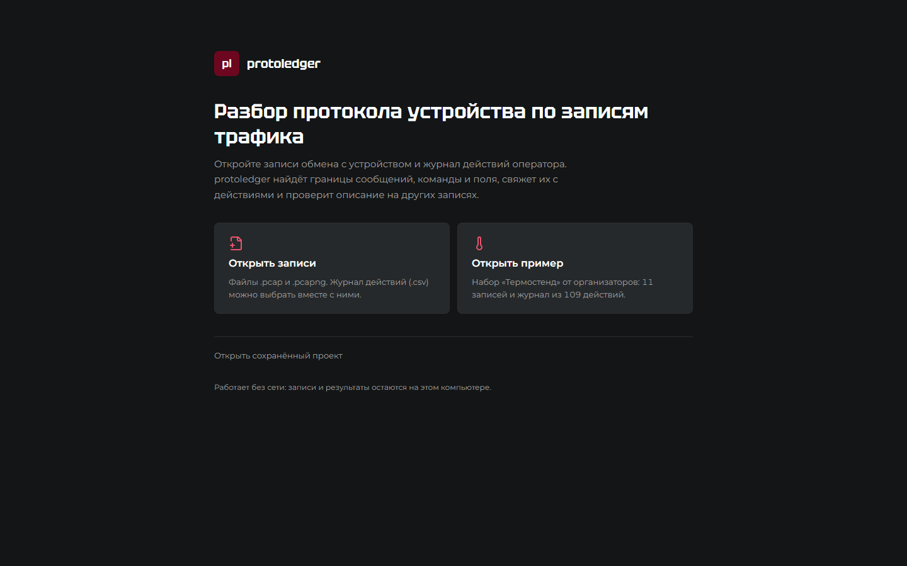

Получается 11 записей и 109 действий. Для каждой записи видно число кадров и соединений и замечания к захвату: повторы, пропуски, обрезанные кадры, перекрытие с разными байтами, нет начала соединения, контрольная сумма, которую считала сетевая карта (`07_checksum_offload`), испорченная сумма (`08_bad_checksum`). Как поступать с перекрытием и плохой суммой, задаётся справа: «брать первое / брать последнее / отметить», «игнорировать / предупреждать / отбрасывать».

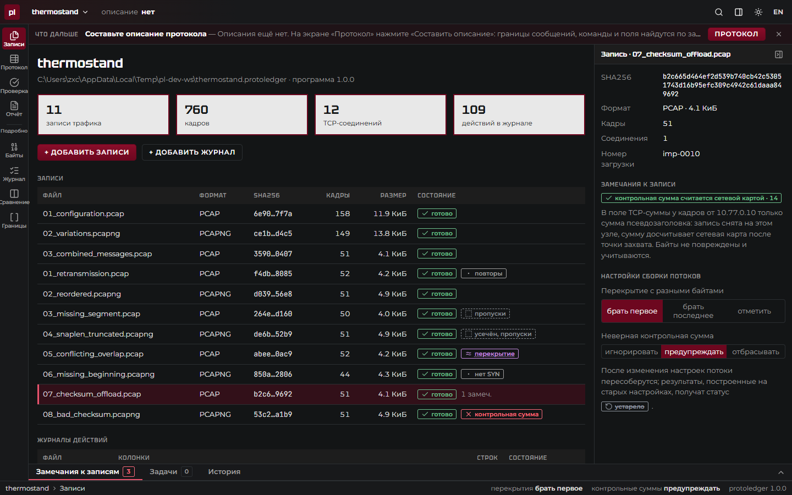

## 2. Описание протокола

«Протокол» → «Составить описание». Программа разбирает записи без дефектов захвата и находит:

- **границы сообщений** — сигнатура `A6 5C` в начале и длина в байтах 2–3 (число, старший байт первым, плюс 8 байт заголовка): этим правилом весь поток режется без остатка;
- **сообщения** — байт 6 отличает запросы клиента от ответов устройства, байт 7 — код команды (0x10, 0x20, 0x30);
- **поля** — байты, которые меняются вместе с параметрами из журнала: порог в байтах 11–12 равен `threshold_c × 100`, период — `period_ms` и т. д.

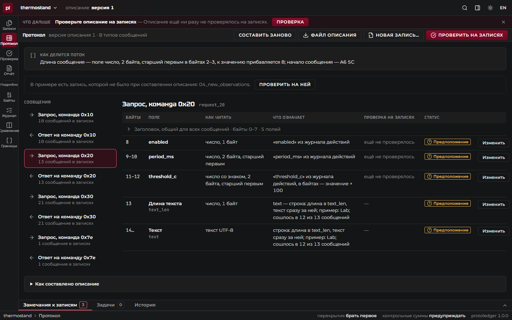

Для каждого поля: байты, как их читать, что они означают, итог проверки на записях и статус — «установлено», «предположение» или «не описано». Заголовок, общий для всех сообщений, свёрнут в одну строку.

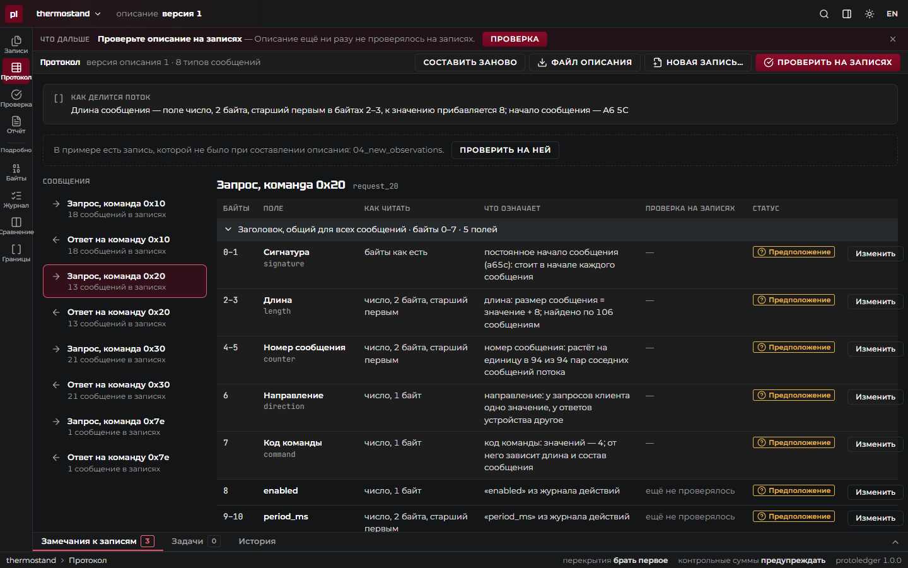

## 3. Проверка на записях

«Проверить на записях» применяет описание ко всем записям проекта: 200 сообщений, у полей из журнала — «совпало в 40 из 40». Сообщения из записей с дыры и перекрытиями — «неполные» и «неоднозначные»: они не выдаются ни за нарушение протокола, ни за успех.

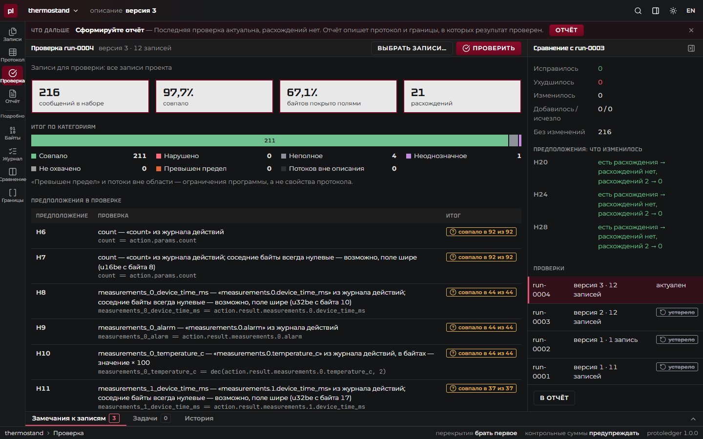

## 4. Дополнительная запись

«Новая запись…» или в примере — «Проверить на ней» (`04_new_observations` — её не было при составлении описания). Без единой правки: 16 сообщений из 16.

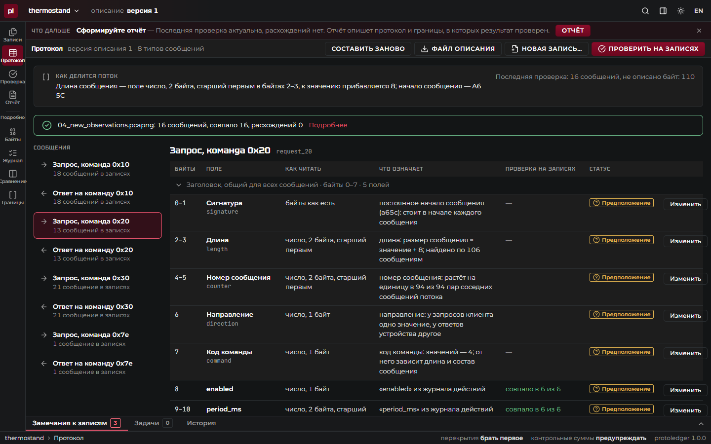

## 5. Ошибка и уточнение

Допустим, исследователь решил, что порог — число без знака: «Изменить» у поля `threshold_c` → «число, 2 байта, старший первым» → «Сохранить» (новая версия описания) → «Проверить на записях». В записях есть отрицательный порог −2,5 °C: в байтах `FF 06`, без знака это 65 286. Проверка показывает расхождения на конкретных сообщениях.

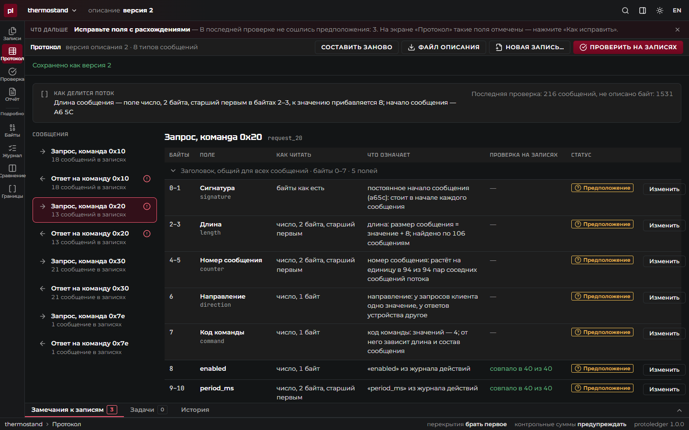

«Как исправить» перебирает варианты — знак, порядок байтов, ширину, масштаб — и показывает, какой убирает расхождения: «читать как число со знаком — расхождений 0 вместо 2». «Применить и проверить» сохраняет новую версию и проверяет заново; прежняя проверка помечается устаревшей.

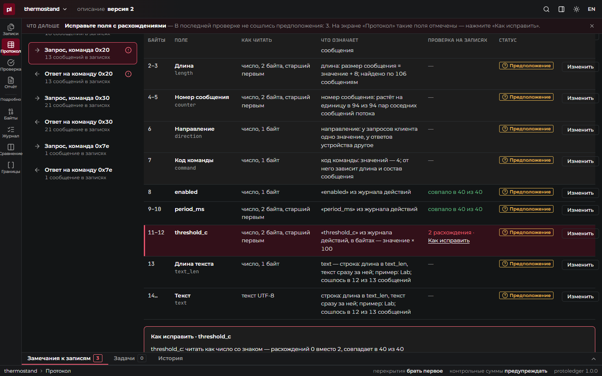

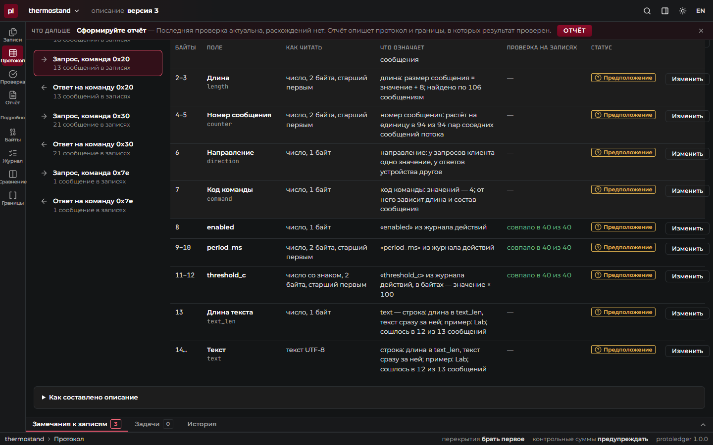

Формулировка намеренно осторожная: «совпало в 40 из 40» — это не «доказано». За пределами наблюдавшихся значений предположение не проверено, и программа об этом говорит.

## 6. Отчёт

«Отчёт» начинается с описания протокола: по каждому сообщению таблица «байты — поле — как читать — что означает — статус — проверка». Дальше — на каких записях проверено, итог проверки, предположения, замечания к захвату, открытые вопросы и как повторить результат. «Скачать HTML» даёт самодостаточный файл без скриптов и внешних ресурсов; «Файл описания» — описание для программ (YAML).

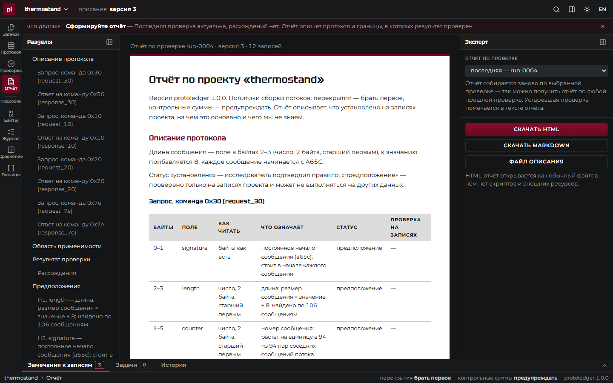

```bash
protoledger report examples/thermostand/project/thermostand.protoledger --format html --out report.html
```

## 7. Подробно: байты, журнал, сравнение

- **Байты** — собранный поток соединения: границы сегментов TCP и сообщений, дыры, повторы; выделенные байты — с номером кадра и смещением в нём.
- **Журнал** — каждое действие оператора и найденный для него обмен «запрос → ответ» в окне времени.
- **Сравнение** — сообщения одного действия с разными параметрами рядом: какие байты меняются и с каким параметром журнала они совпадают.
- **Границы** — все найденные варианты поля длины и сигнатуры с основаниями.

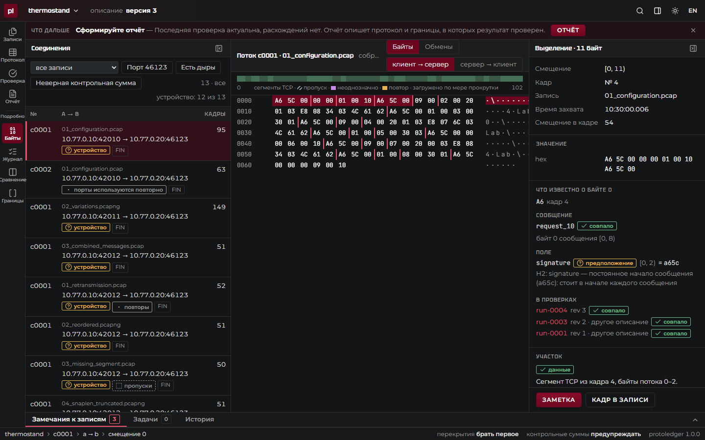

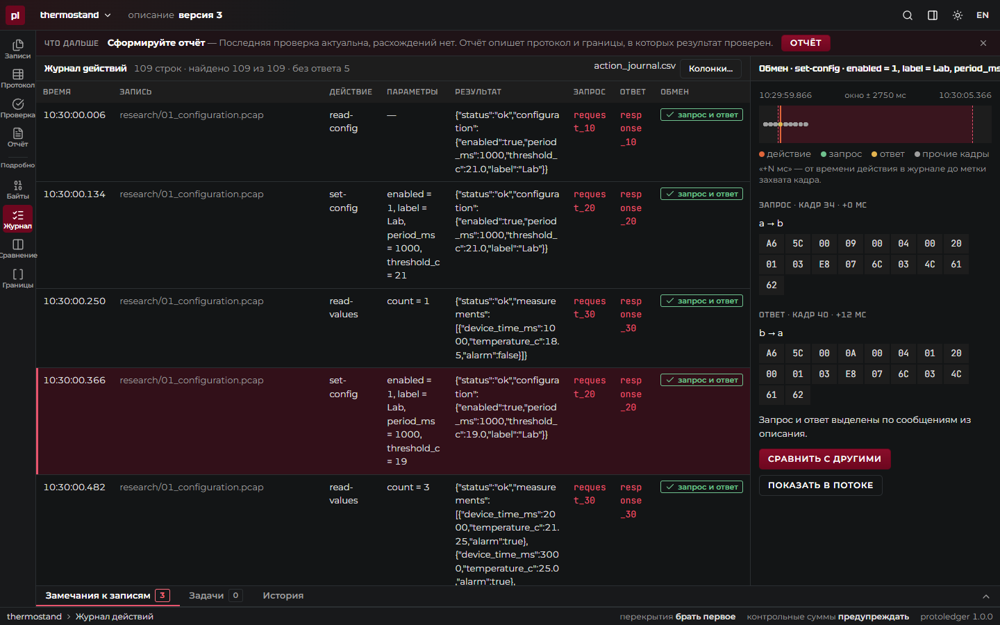


## 8. Передать и повторить

Проект — обычная папка без абсолютных путей: её можно скопировать на другую машину и открыть кнопкой «Открыть сохранённый проект». Проверить, что копии записей целы и все проверки воспроизводятся:

```bash
protoledger verify examples/thermostand/project/thermostand.protoledger
```

Применить описание к новой записи без проекта и интерфейса — результат тот же, что на экране «Проверка»:

```bash
S=examples/thermostand/sample_protocol
protoledger apply --interpretation examples/thermostand/interpretation.yaml \
  --input $S/additional/04_new_observations.pcapng \
  --action-log $S/action_journal.csv --mapping examples/thermostand/mapping.yaml
```

Коды возврата: 0 — совпало, 1 — есть отличия, 2 — ошибка.

Черновик описания из командной строки — то же, что кнопка «Составить описание»:

```bash
protoledger draft \
  --input $S/research/01_configuration.pcap --input $S/research/02_variations.pcapng \
  --input $S/research/03_combined_messages.pcap \
  --action-log $S/action_journal.csv --mapping examples/thermostand/mapping.yaml \
  --out draft.yaml
```

| Команда | Что показывает |
|---|---|
| `protoledger coverage --interpretation … --input …` | Какие байты описаны, какие — предположения, какие не описаны |
| `protoledger compare --interpretation … --a … --b …` | Чем второй набор записей отличается от первого: новые и пропавшие типы сообщений, новые значения полей |
| `protoledger graph --interpretation … --input … --dot` | Какой ответ приходит на какой запрос; вывод — для Graphviz |
| `protoledger export --interpretation … --name thermostand` | То же описание как диссектор Wireshark ([пример](../examples/thermostand/README.md)) |

Подробно о командах — в [документации движка](https://github.com/protoledger/protoledger-backend/blob/main/docs/cli.md). Чем каждое требование задания подтверждено — в [requirements.md](requirements.md).
