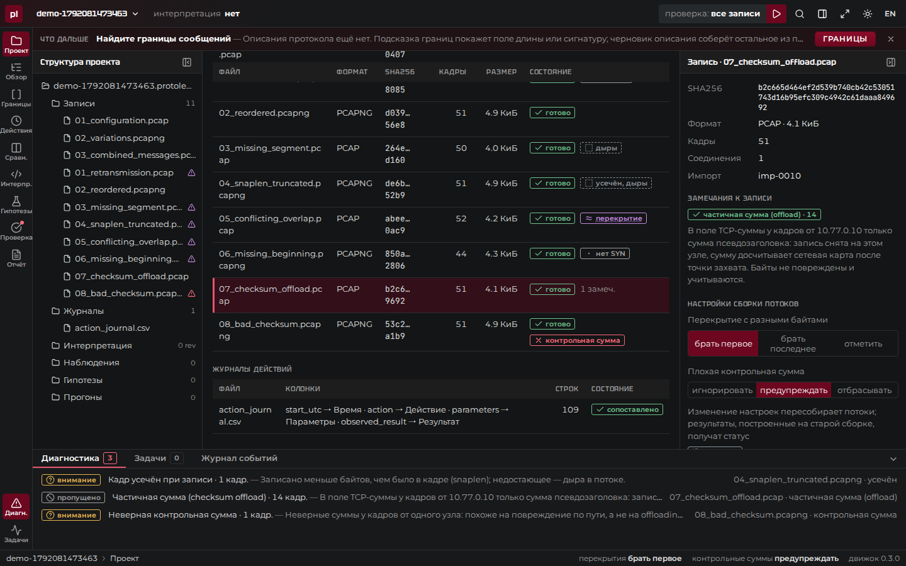
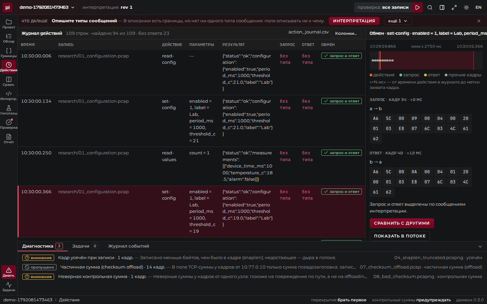
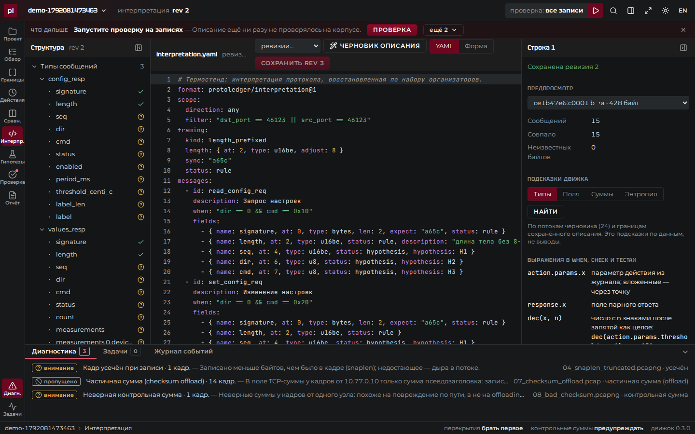

# Как пользоваться: исследование шаг за шагом

Один проход полного цикла «наблюдение → гипотеза → проверка → уточнение» на наборе организаторов «Термостенд» (`examples/thermostand/sample_protocol`): штатный клиент общается с моделью измерительного устройства, рядом лежит журнал действий оператора. Протокол считается неизвестным.

Каждый шаг показан в интерфейсе; где есть команда с тем же результатом — она приведена рядом. Запуск приложения — в [README](../README.md#быстрый-старт). Всё, что получится в конце, уже лежит в репозитории как готовый проект: `examples/thermostand/project`.

| Экран | Что на нём делают |
|---|---|
| Проект | Записи, журналы действий, настройки сборки потоков |
| Обзор записей | Соединения и байты потоков |
| Границы | Поиск границ сообщений |
| Действия | Журнал действий и обмен для каждого действия |
| Сравнение | Сообщения одного действия с разными параметрами |
| Интерпретация | Описание протокола: текст и форма |
| Гипотезы и вопросы | Наблюдения, гипотезы с тестами, открытые вопросы |
| Проверка | Прогон описания на корпусе, контрпримеры, сравнение прогонов |
| Отчёт | Итог исследования для передачи |

## 1. Проект и записи

На экране «Проект» создайте проект: это папка `*.protoledger` в каталоге проектов. Кнопкой «Импорт записей» добавьте три записи из `research/` и восемь из `diagnostics/`, кнопкой «Журнал действий» — `action_journal.csv`. Колонки журнала движок угадывает сам по заголовкам и содержимому и показывает основания: время — `start_utc`, действие — `action`, параметры — `parameters`, результат — `observed_result` (оба в JSON), запись — `capture`. Проверьте и нажмите «Импортировать».

Что должно получиться: 11 записей, у каждой sha256, число кадров и состояние «готово»; 109 действий в журнале. Записи копируются в проект и больше не меняются. Внизу, на вкладке «Диагностика», — то, что не вошло в потоки или разобрано с оговорками: усечённый кадр в `04_snaplen_truncated`, частичные контрольные суммы в `07_checksum_offload`, неверная сумма в `08_bad_checksum`.



## 2. Потоки: что собрано и чего не хватает

«Обзор записей» показывает соединения TCP с пометками: «повторы», «дыры», «нет SYN», «не закрыто». Откройте соединение и направление «клиент → сервер»: байты потока собраны по номерам последовательности, повторная передача не задваивает данные, дыра показана как дыра с числом недостающих байтов, а не заполнена. Выделите байты — справа появится, из какого они кадра и с каким смещением; кнопка «Наблюдение» сохраняет заметку с якорем на эти байты.


Диагностические записи набора нужны как раз для этого шага: один и тот же обмен с повтором, перестановкой, потерей сегмента, усечением кадра, противоречивым перекрытием, без начала соединения и с испорченной суммой. Как поступать с перекрытием и плохой суммой, задаётся в свойствах проекта: перекрытие — «брать первое», «брать последнее» или «отметить» (участок помечается неоднозначным), плохая сумма — «игнорировать», «предупреждать» или «отбрасывать»; смена настройки помечает прежние прогоны устаревшими.

## 3. Границы сообщений

На экране «Границы» движок перебирает способы разбить поток на сообщения и показывает основания. Для «Термостенда» первый кандидат — поле длины `u16`, старший байт первым, по смещению 2, поправка +8: подтверждается на всех сообщениях. Ниже — сигнатура `A6 5C` в начале каждого сообщения и карта изменчивости байтов по смещениям. Границы сегментов TCP и сообщений видны одновременно: несколько сообщений в одном сегменте и сообщение на нескольких сегментах различимы глазами. Кандидата можно принять как фрейминг описания.


## 4. Действия и обмены

Экран «Действия» — журнал оператора: время, действие, параметры, результат. Для выбранного действия движок находит в окне времени запрос и ответ на него и показывает их байты. Возьмите `set-config` с порогом 19: в запросе видны байты `07 6C` — это 1900.



На «Сравнении» те же действия с разными параметрами стоят рядом: постоянные байты отделены от меняющихся, а меняющиеся сопоставлены со значениями из журнала — порог оказывается числом в сотых долях градуса, период — в миллисекундах. Каждая такая связь — основание для поля описания, но ещё не доказательство.


## 5. Описание протокола

На экране «Интерпретация» описание пишется текстом (YAML) или через форму; формат — в [formats.md](formats.md). В нём фрейминг, типы сообщений с условиями, поля и гипотезы с тестами. У каждого поля статус: «правило», «гипотеза» или «неизвестно» — догадка никогда не выглядит как установленный факт. Каждое сохранение — новая ревизия; старые остаются.

Вставьте `examples/thermostand/interpretation.yaml`, но с ошибкой, которую легко допустить: поле `threshold_centi_c` — `u16be` вместо `i16be`. В записях исследования почти все пороги положительные, и ошибку не видно.



## 6. Проверка на корпусе

«Проверка» → «Запустить»: описание применяется ко всем записям проекта. Итог: 200 сообщений, 195 совпало, 4 неполных, 1 неоднозначное — последние пришли из диагностических записей и не выдаются ни за нарушение протокола, ни за успех.

В таблице «Гипотезы в прогоне» у каждой гипотезы — на скольких примерах тест выполнился. H6 (порог равен значению из журнала) и H12 опровергнуты: в `02_variations` оператор задал порог −2,5 °C, а описание прочитало 65286. Контрпример показан с потоком, диапазоном байтов и строкой журнала; щелчок по нему открывает это сообщение в «Обзоре записей».


## 7. Дополнительная запись

Импортируйте `additional/04_new_observations.pcapng` — её не было, когда писалось описание. «Корпус…» → «Только 04_new_observations» → «Запустить на корпусе». Без единой правки: 16 сообщений из 16 разобраны. Тест H6 снова опровергнут — теперь на пороге −10 °C.

## 8. Уточнение

В редакторе у поля с контрпримерами движок предлагает исправление и сразу показывает его цену: «u16be → i16be: контрпримеров 8 → 0». Примите его — появится ревизия 2. Запустите проверку на всём корпусе: 216 сообщений, контрпримеров нет. Прежние прогоны помечены «устарело», а сравнение прогонов показывает, что именно изменилось: «H6: опровергнута → контрпримеров нет».


Формулировка намеренно осторожная: «поддержана на 40 из 40 примеров» — это не «доказана». За пределами наблюдавшихся значений гипотеза не проверена, и интерфейс об этом говорит.

## 9. Отчёт

Экран «Отчёт»: область применимости (записи с sha256, условия проверки), результат проверки по категориям и типам, гипотезы с итогами тестов и контрпримерами, наблюдения с якорями, открытые вопросы, способ воспроизвести. «Скачать HTML» даёт самодостаточный файл без скриптов и внешних ресурсов; «Интерпретация YAML» — машиночитаемое описание.


```bash
protoledger report examples/thermostand/project/thermostand.protoledger --format html --out report.html
```

## 10. Передать и повторить

Проект — обычная папка без абсолютных путей: её можно скопировать на другую машину. Проверить, что копии записей целы и все прогоны воспроизводятся:

```bash
protoledger verify examples/thermostand/project/thermostand.protoledger
```

Применить описание к новой записи без проекта и интерфейса — результат тот же, что на экране «Проверка»:

```bash
S=examples/thermostand/sample_protocol
protoledger apply --interpretation examples/thermostand/interpretation.yaml \
  --input $S/additional/04_new_observations.pcapng \
  --action-log $S/action_journal.csv --mapping examples/thermostand/mapping.yaml
```

Коды возврата: 0 — совпало, 1 — есть отличия, 2 — ошибка.

## Тот же путь из командной строки

Шаги 3–5 движок умеет предложить сам. Черновик описания собирается по записям и журналу без каких-либо сведений о протоколе:

```bash
protoledger draft \
  --input $S/research/01_configuration.pcap --input $S/research/02_variations.pcapng \
  --input $S/research/03_combined_messages.pcap \
  --action-log $S/action_journal.csv --mapping examples/thermostand/mapping.yaml \
  --out draft.yaml
```

Команда печатает, что и на каком основании найдено: длина `u16be` по смещению 2 с поправкой 8 без контрпримеров, начало `a65c`, тип сообщения по байтам 6 и 7, счётчик `u16be` по смещению 4, строки с длиной, поля, равные значениям из журнала. Каждое поле в `draft.yaml` — гипотеза, имена условные: это отправная точка для исследователя, а не готовый ответ. На дополнительной записи такой черновик разбирает 16 сообщений из 16.

| Команда | Что показывает |
|---|---|
| `protoledger coverage --interpretation … --input …` | Какие байты описаны правилом, какие гипотезой, какие не описаны вовсе |
| `protoledger compare --interpretation … --a … --b …` | Чем второй набор записей отличается от первого: новые и пропавшие типы сообщений, новые значения полей, время ответа |
| `protoledger graph --interpretation … --input … --dot` | Какой ответ приходит на какой запрос и что идёт следом; вывод — для Graphviz |
| `protoledger export --interpretation … --name thermostand` | То же описание как диссектор Wireshark ([пример](../examples/thermostand/README.md)) |

Подробно о командах — в [документации движка](https://github.com/protoledger/protoledger-backend/blob/main/docs/cli.md). Чем каждое требование задания подтверждено — в [requirements.md](requirements.md).
